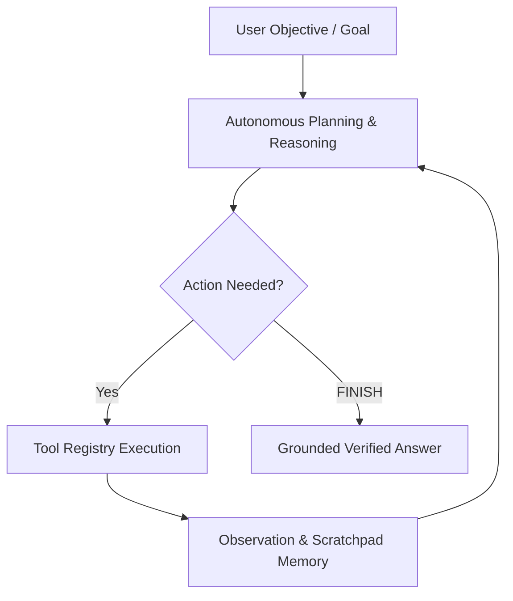

# 🤖 OmniAgent

> **Autonomous Multi-Tool Problem-Solving Agent with Self-Healing Loops and Vector Retrieval.**  
> Built by **David Erikefe (davebuiltit)**.

[](#architecture)
[](https://nodejs.org)
[](#tools)
[](LICENSE)

---

## Overview

Most AI applications are simple single-turn prompt wrappers that fail as soon as an unexpected response or timeout occurs.

**OmniAgent** is an autonomous, goal-directed agent implementing the **ReAct (Reasoning + Acting)** framework. Given an open-ended objective, OmniAgent breaks down the problem, selects and invokes tools from its internal registry, stores intermediate observations in an execution scratchpad, and iterates toward a verified solution.

---

## Architecture: ReAct Loop



### Integrated Tool Registry

1. **`fetch_url_telemetry`**: Probes live web endpoints, checking status codes, server headers, and network latency.
2. **`calculate`**: Evaluates mathematical formulas, ROI metrics, and statistical aggregations safely in-process.
3. **`vector_match`**: Computes dense vector semantic similarities across candidate documents without external token costs.
4. **`validate_schema`**: Deterministic schema validation verifying compliance rules.

---

## Getting Started

### Installation
```bash
git clone https://github.com/erikefedavid/OmniAgent.git
cd OmniAgent
npm start
```

### Example Execution

```text
=======================================================
 🤖 OmniAgent: Autonomous Problem-Solving Agent
=======================================================

[OmniAgent] Initiating goal: "Probe https://daviderikefe.vercel.app telemetry and calculate 2500 * 4 * 18 / 60"
[OmniAgent] Iteration 1/6
[OmniAgent] Thought: I need to probe the network telemetry and latency for https://daviderikefe.vercel.app.
[OmniAgent] Executing tool: fetch_url_telemetry with input: {"url":"https://daviderikefe.vercel.app"}
[OmniAgent] Observation: {"success":true,"status":200,"latencyMs":142}
[OmniAgent] Iteration 2/6
[OmniAgent] Thought: Calculating mathematical metric using expression: 2500 * 4 * 18 / 60.
[OmniAgent] Executing tool: calculate with input: {"expression":"2500 * 4 * 18 / 60"}
[OmniAgent] Observation: {"success":true,"result":3000}
[OmniAgent] Iteration 3/6
[OmniAgent] Thought: All required tool observations collected. Synthesizing final answer.
[OmniAgent] Resolved objective: Completed objective successfully with 2 autonomous tool executions.
```

---

## Author

**David Erikefe-Dickson (davebuiltit)**  
- Portfolio: [daviderikefe.vercel.app](https://daviderikefe.vercel.app/)  
- GitHub: [@erikefedavid](https://github.com/erikefedavid)  
- Twitter: [@Davebuiltit](https://x.com/Davebuiltit)  
